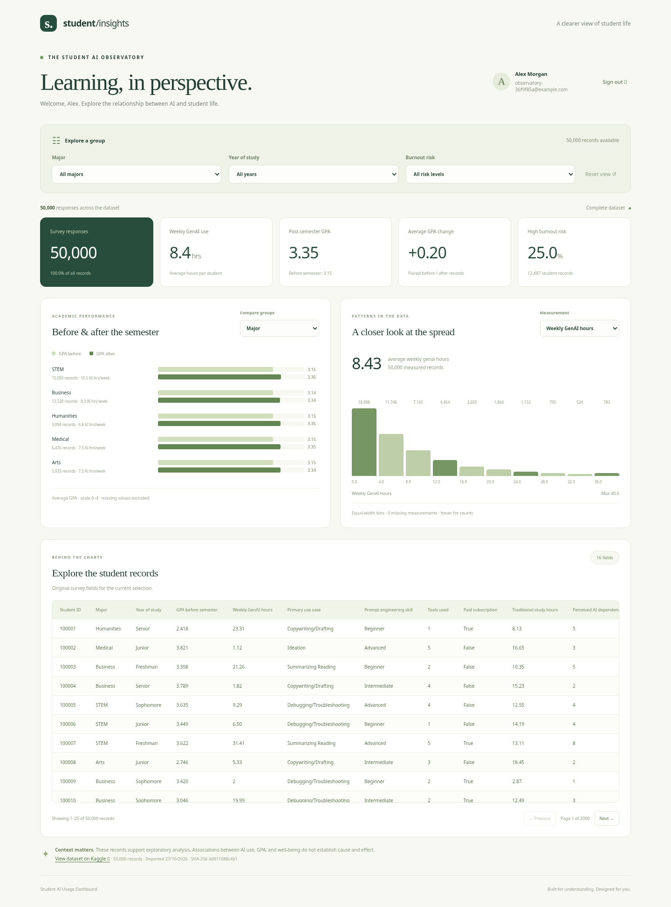
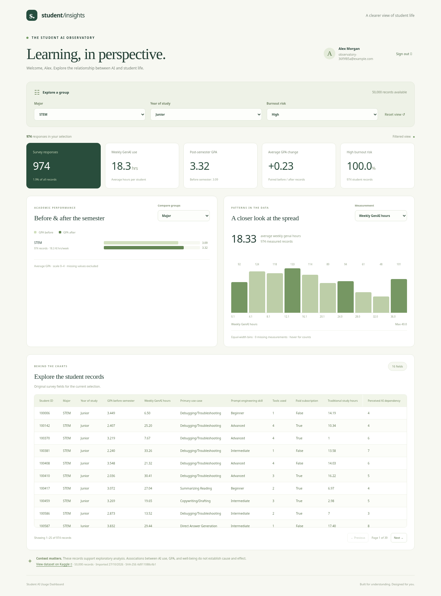
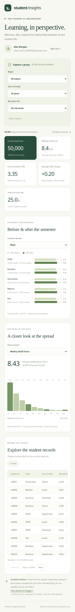

# Дашборд використання AI студентами

Після реєстрації або входу користувач одразу бачить аналітику на основі наданого
`ai_impact_on_students.csv`: **50 000 записів, 16 колонок**. Оновлення сторінки
відновлює сесію й знову відкриває дашборд.

## Огляд

П'ять карток показують кількість записів, середні години GenAI на тиждень, GPA
після семестру, середню зміну GPA та частку записів із високим ризиком вигорання.
Графіки порівнюють GPA до/після семестру за вибраними групами та показують
розподіл вибраного числового показника. Таблиця містить усі 16 полів і завантажує
по 25 записів за сторінку.

## Фільтри й дослідження даних

1. Виберіть спеціальність, рік навчання та/або ризик вигорання.
2. Картки, обидва графіки та таблиця перерахуються для цієї вибірки.
3. У `Compare groups` змініть категорію порівняння GPA, наприклад політику закладу.
4. У `Measurement` виберіть інший числовий показник, наприклад збереження навичок.
5. Перегортайте таблицю кнопками `Previous` / `Next`. Після зміни фільтрів
   відкривається перша сторінка. `Reset view` повертає початковий огляд.

Середні значення не включають пропуски; зміна GPA обчислюється лише для записів
із обома вимірюваннями. Порожня вибірка, відсутній датасет і помилка завантаження
мають окремі стани; після помилки доступна кнопка повторної спроби.

## Мобільний вигляд

Відкрити скриншот шириною 390 px

Широка таблиця прокручується всередині свого контейнера. Сторінка не має
горизонтального переповнення на ширині 390 px.

## Як запустити

Дотримуйтеся [основного README](../README.md#quick-start-everything-in-docker):
налаштуйте `JWT_SECRET`, запустіть `docker compose up --build --wait`, відкрийте
`http://localhost:8080` і зареєструйтеся або увійдіть.

CSV включено в бекенд. Перед початком обслуговування запитів застосунок перевіряє
файл та заповнює PostgreSQL. Завантажувати дані з Kaggle під час входу не потрібно.
Повторний запуск із тією самою SHA-256 не змінює записи. Новий валідний файл
замінює спільний датасет атомарно, не змінюючи акаунти чи сесії. Помилка імпорту
відкочує всю заміну. Джерело, контрольна сума й час імпорту доступні внизу сторінки.

API `/api/dashboard` перевіряє наявну авторизацію та відкликає доступ після виходу.
Клієнт отримує агрегати й поточну сторінку таблиці, а не весь CSV.
[Контракт імпорту й походження даних](../backend/data/README.md).

## Перевірки

- 19 тестів із реальною окремою PostgreSQL: авторизація, захищений API, імпорт,
  контрольна сума, відсутність дублікатів, відкат після помилки запису, фільтри,
  агрегати, пропуски, сталі значення, пагінація й порожня база.
- Ruff і збірка TypeScript/Vite.
- Повний Docker Compose з порожнім томом PostgreSQL: автоматичний імпорт,
  готовність усіх сервісів, повторний імпорт `unchanged` і рівно 50 000 записів.
- Chromium: реєстрація, вхід, відновлення сесії, комбіновані фільтри, перемикання
  показників/груп, пагінація, вихід, повторна спроба після помилки та мобільний вигляд.
- Показники API для повного датасету й вибірок звірено з незалежним читанням CSV.

Скриншоти зроблено з працюючого React/FastAPI/PostgreSQL на наданому CSV.
Обліковий запис на скриншотах створено лише для локальної демонстрації.
Поведінку помилки та порожнього датасету в браузері перевірено окремими
тестовими відповідями API; демонстраційні скриншоти показують справжні дані.
